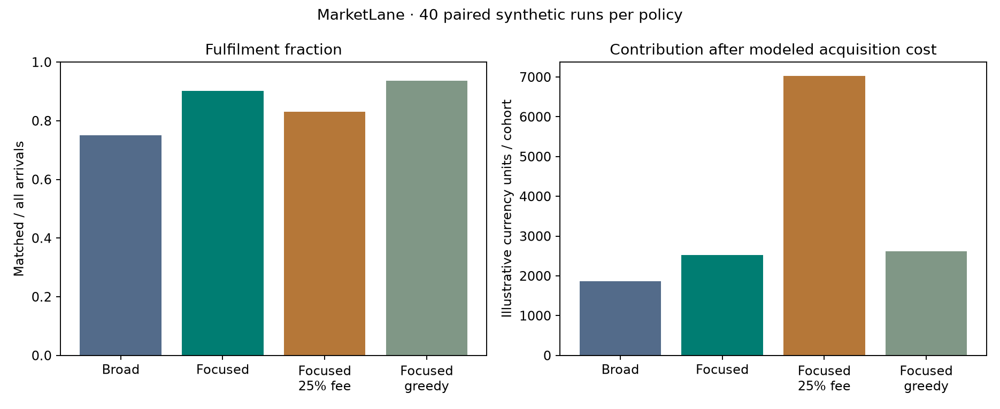

# MarketLane

**Test a marketplace launch assumption before spending on supply or acquisition.**

MarketLane models a two-sided creative-services market with supplier capacity, skill compatibility, minimum payouts,
buyer budgets, quality requirements and expiring demand. It compares launch breadth, fee choices and matching policies,
then reconciles fulfilment, seller earnings and platform contribution. This is a decision-support simulator, not a
system for ranking real job applicants.



## A useful finding from the model

Across 40 paired seeds, the focused oldest-first baseline filled **93.7%** of synthetic demand; a daily matching optimizer
filled **90.3%**. The optimizer wins its daily objective but ignores the cost of leaving older jobs to expire.
That makes the simpler baseline the preferred pilot candidate under these assumptions.

The broader eight-category scenario filled **75.1%**. Raising the focused scenario fee to 25% increased modeled
contribution but reduced fill to **83.0%**. These are simulated trade-offs, **not forecasts, observed adoption or revenue**.

Read the [decision memo](reports/decision.md), [160 comparison runs](reports/simulation_runs.csv),
[108 sensitivity runs](reports/sensitivity.csv), and [paired intervals](reports/metrics.json).

## Run

```sh
python3 -m venv .venv
source .venv/bin/activate
pip install -e '.[dev]' -c constraints.txt
python -m marketlane demo
pytest -q
```

For a custom scenario:

```sh
python -m marketlane simulate --config data/focused.json --seed 4 --output local-results
```

Open `reports/tradeoff.html` locally for the interactive simulation scatterplot. No external service is required.

## What is implemented

- Daily arrivals, availability and eligibility, with one service slot per available supplier.
- Oldest-first greedy allocation and maximum-cardinality / maximum-surplus assignment with explicit unmatched options.
- Shared exogenous random streams for policy comparisons, plus cohort draining after arrivals stop.
- A transaction ledger: GMV equals supplier payout plus platform fees. Contribution deducts processing, support and
  acquisition cost for all arriving buyers, including those who fail to match.
- Paired bootstrap intervals on simulated mean differences, demand/fee sensitivity, seller concentration diagnostics.
- Independent brute-force checks of small assignment problems and financial/conservation tests.

[Product brief](docs/product-brief.md) · [Decision records](docs/decisions.md) · [Validation](docs/validation.json)

## Limits that affect the decision

Every economic parameter is an assumption. No customer research, willingness-to-pay measurement or market validation
is claimed. Fee changes affect seller payout feasibility, but behavioral price elasticity is not estimated. Repeat
purchases, churn, strategic responses, service failures and fixed operating expenses are omitted. Bootstrap intervals
measure finite-simulation uncertainty, not uncertainty about whether the model describes a real market. Gini measures
earnings concentration, not fairness. Human research and a bounded pilot are prerequisites for a launch recommendation.

[Assignment solver documentation](https://docs.scipy.org/doc/scipy/reference/generated/scipy.optimize.linear_sum_assignment.html)

MIT-licensed source. Initial implementation: November 2026.
